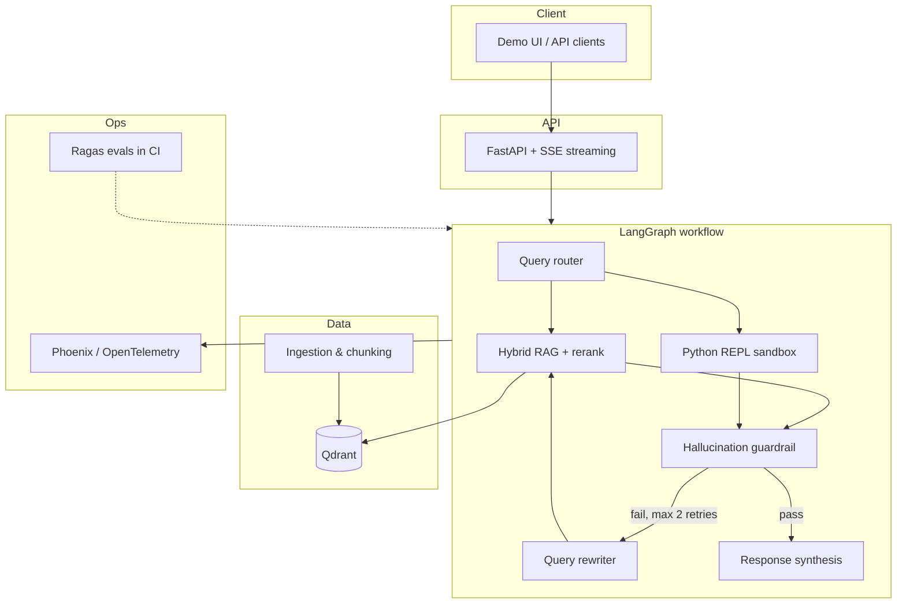

# DocPulse

**Agentic RAG platform for financial and legal document analysis**

**Repository:** [github.com/Cluia/Agentic-RAG-platform](https://github.com/Cluia/Agentic-RAG-platform)

DocPulse is a portfolio-grade system that answers complex questions over large PDF corpora (reports, contracts, balance sheets). It combines **hybrid retrieval**, **LangGraph orchestration**, **sandboxed numeric computation**, and **automated quality evaluation** — the kind of end-to-end stack expected in production AI engineering roles.

> **Status:** Sprint 0 complete — naive RAG API, Qdrant ingestion, Docker Compose.

---

## Why this project exists

Simple RAG often fails on real document sets for two reasons:

1. **Cross-document synthesis** — answers require connecting facts spread across multiple files.
2. **Quantitative answers** — LLMs hallucinate metrics; tables and formulas need deterministic computation.

DocPulse routes each query through an explicit agent workflow: retrieve with hybrid search and reranking, run Python when the question is numeric, validate faithfulness before returning, and retry with query rewriting when context is insufficient.

---

## Architecture (target)



---

## Capabilities roadmap

| Area | Description | Sprint |
|------|-------------|--------|
| Baseline RAG | PDF ingest, embeddings, Qdrant, `POST /chat` | **0** ✓ |
| Hybrid retrieval | Dense vectors + BM25, fusion (RRF), rerank top-K | 1 |
| Agent graph | Router, code tool, guardrail, rewriter loops | 2 |
| Production API | Async endpoints, SSE, tracing per graph node | 3 |
| Quality gates | Ragas metrics in CI, lint (Ruff), types (mypy) | 4 |

Planned comparison modes for benchmarks: `naive_rag` → `hybrid_rerank` → full `agent` (same golden dataset).

---

## Tech stack

| Layer | Choice | Role |
|-------|--------|------|
| Orchestration | [LangGraph](https://github.com/langchain-ai/langgraph) | Stateful agent graph, conditional loops |
| API | [FastAPI](https://fastapi.tiangolo.com/) | Async REST, SSE for streamed responses |
| Vector DB | [Qdrant](https://qdrant.tech/) | Dense (+ sparse/hybrid) search with metadata filters |
| Lexical search | BM25 (`rank-bm25` or Qdrant sparse) | Exact terms, clauses, tickers |
| Reranking | FlashRank (default) / Cohere Rerank (optional) | Precision on top-20 → top-4 contexts |
| Parsing | pdfplumber → Unstructured / LlamaParse (upgrade path) | Text + tables from PDFs |
| Code execution | Sandboxed Python REPL | Calculations over extracted table data |
| Observability | Arize Phoenix (OpenTelemetry) | Traces, latency, token usage per node |
| Evaluation | [Ragas](https://docs.ragas.io/) | Faithfulness, answer relevancy, context precision |
| Runtime | Docker Compose, GitHub Actions | Reproducible dev and CI |

---

## Getting started

All commands below assume you are in **`docpulse-agent/`** (where `docker-compose.yml` lives). Running `docker compose` from the repo root will fail with *no configuration file provided*.

### Prerequisites

- Docker Desktop (Compose v2)
- A [Google AI / Gemini API key](https://aistudio.google.com/apikey)

### Environment

```bash
git clone https://github.com/Cluia/Agentic-RAG-platform.git
cd Agentic-RAG-platform/docpulse-agent

cp .env.example .env
# Set GEMINI_API_KEY (or GOOGLE_API_KEY) in .env — never commit .env
```

Default models (override in `.env` if Google rotates names):

| Variable | Default | Purpose |
|----------|---------|---------|
| `EMBEDDING_MODEL` | `gemini-embedding-001` | Vectors for Qdrant (`EMBEDDING_DIMENSIONS=768`) |
| `CHAT_MODEL` | `gemini-3.8-flash` | Naive RAG answer generation |

### Run the stack

```bash
docker compose up --build
```

| Service | URL |
|---------|-----|
| API | `http://localhost:8000` |
| OpenAPI | `http://localhost:8000/docs` |
| Qdrant | `http://localhost:6333/dashboard` |
| Phoenix UI | planned (Sprint 3) |

### Index sample data and chat

**Bash / Git Bash:**

```bash
curl -X POST http://localhost:8000/ingest -H "Content-Type: application/json" -d '{"path": "sample"}'

curl -X POST http://localhost:8000/chat -H "Content-Type: application/json" \
  -d '{"question": "What was Northwind net margin in FY2024?"}'
```

**PowerShell** (native `curl` is an alias for `Invoke-WebRequest` — use `curl.exe` or):

```powershell
Invoke-RestMethod -Method POST -Uri http://localhost:8000/ingest `
  -ContentType "application/json" -Body '{"path": "sample"}'

Invoke-RestMethod -Method POST -Uri http://localhost:8000/chat `
  -ContentType "application/json" `
  -Body '{"question": "What was Northwind net margin in FY2024?"}'
```

Expected smoke answer: **net margin 20.3%** (from `data/sample/northwind_fy2024_and_msa.txt`).

### Ingest via CLI (inside the container)

```bash
docker compose exec api python scripts/ingest.py data/sample
```

Same pipeline as `POST /ingest`, useful for local debugging without HTTP.

### Sprint 0 verification (recommended before Sprint 1)

From `docpulse-agent/` with the stack running and `.env` configured:

```bash
# Cold start: wipe Qdrant volume, recreate stack, ingest + numeric + MSA chat (~2–10 min)
docker compose down -v && docker compose up -d --build
python scripts/smoke_sprint0_cold_start.py --require-empty --verbose
```

Additional checklist scripts (same folder):

```bash
python scripts/smoke_sprint0_cli_ingest.py --verbose      # CLI vs API ingest
python scripts/smoke_sprint0_pdf.py --verbose             # PDF parse + chat
python scripts/smoke_sprint0_api_edges.py --verbose     # HTTP edge cases + /docs
# For empty-index /chat check: run api_edges right after `down -v && up -d` (before other smokes)
```

Regenerate the sample PDF if missing:

```bash
python scripts/generate_sample_pdf.py
```

Optional live pytest (requires `DOCPULSE_E2E=1`, stack up, `-s` for progress logs):

```bash
DOCPULSE_E2E=1 pytest tests/e2e -s
```

**Sprint 0 done when:** cold-start smoke passes, PDF smoke passes, API edge smoke passes, and unit tests pass (`pytest tests/unit`).

`/chat` calls can take **1–5 minutes each** (Gemini latency + retries). Watch progress in the smoke scripts or `docker compose logs api -f`.

### Local Python (optional)

From `docpulse-agent/`, create a venv, `pip install -r requirements.txt`, copy `.env`, start Qdrant only (`docker compose up qdrant -d`), set `QDRANT_URL=http://localhost:6333`, then:

```bash
python scripts/ingest.py data/sample
uvicorn app.main:app --app-dir src --reload
```

---

## Repository layout

```text
docpulse-agent/
├── docker-compose.yml
├── Dockerfile
├── requirements.txt
├── scripts/
│   ├── ingest.py
│   ├── smoke_sprint0_cold_start.py
│   └── …                     # Sprint 0 checklist smokes
├── src/
│   ├── app/                  # FastAPI
│   ├── core/                 # Config, Gemini client
│   └── ingestion/            # Parse, chunk, Qdrant
├── data/sample/              # Demo .txt + PDF (`acme_fy2024_summary.pdf`)
└── tests/
    ├── unit/
    └── e2e/                  # Live stack tests (DOCPULSE_E2E=1)
```

Future sprints add `src/agent/`, `src/tools/`, `.github/workflows/`, and `tests/evals/`.

---

## Evaluation (planned)

Golden questions over a small public or synthetic corpus (multi-doc + numeric). Metrics reported in README and CI artifacts:

- **Faithfulness** — claims supported by retrieved context  
- **Answer relevancy** — response matches the question  
- **Context precision** — retrieved chunks are on-topic  

Target narrative for this repo: measure uplift from reranking and from the agent guardrail vs naive RAG on the **same** eval set.

---

## Design decisions (ADR summary)

- **Qdrant over Chroma** — hybrid search, payload filters, production-oriented ops story.  
- **FlashRank first** — no extra API key; Cohere as optional `.env` switch.  
- **Phoenix first** — local, OpenTelemetry-native tracing without vendor lock-in for demos.  
- **Explicit naive baseline** — required for credible before/after metrics in a portfolio.  

---

## Author

**Julio** — AI / ML engineering portfolio project.  
Questions and collaboration: open an issue or reach out via LinkedIn.

---

## License

MIT — see [LICENSE](LICENSE) (to be added).
