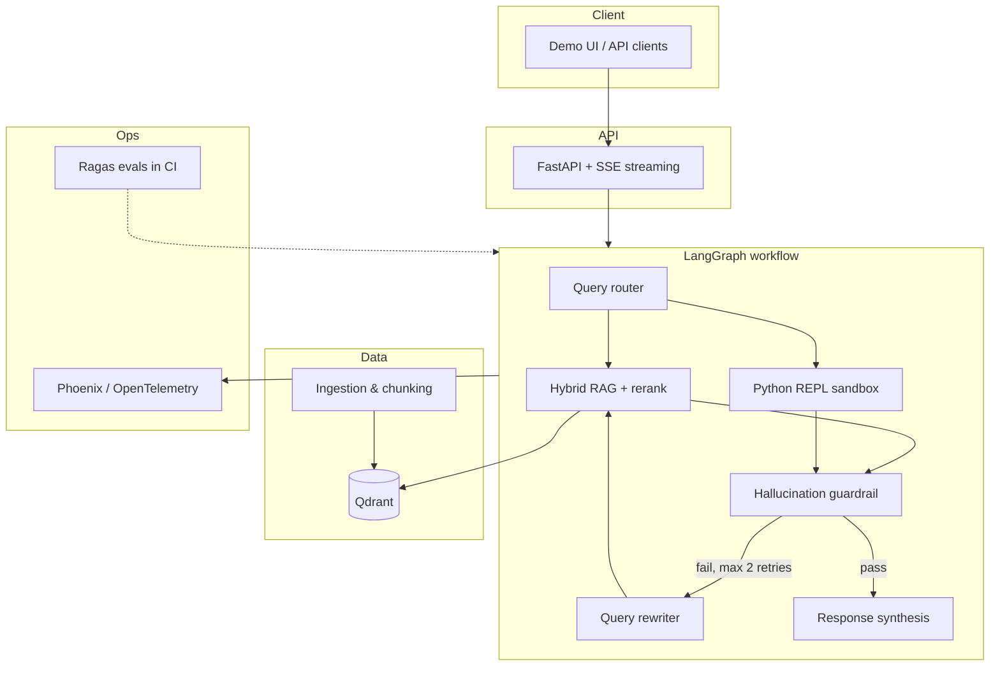

# DocPulse

**Agentic RAG platform for financial and legal document analysis**

**Repository:** [github.com/Cluia/Agentic-RAG-platform](https://github.com/Cluia/Agentic-RAG-platform)

DocPulse is a portfolio-grade system that answers complex questions over large PDF corpora (reports, contracts, balance sheets). It combines **hybrid retrieval**, **LangGraph orchestration**, **sandboxed numeric computation**, and **automated quality evaluation** — the kind of end-to-end stack expected in production AI engineering roles.

> **Status:** Sprint 0 in progress — ingestion pipeline, vector store, and baseline RAG API.

---

## Why this project exists

Simple RAG often fails on real document sets for two reasons:

1. **Cross-document synthesis** — answers require connecting facts spread across multiple files.
2. **Quantitative answers** — LLMs hallucinate metrics; tables and formulas need deterministic computation.

DocPulse routes each query through an explicit agent workflow: retrieve with hybrid search and reranking, run Python when the question is numeric, validate faithfulness before returning, and retry with query rewriting when context is insufficient.

---

## Architecture (target)



---

## Capabilities roadmap

| Area | Description | Sprint |
|------|-------------|--------|
| Baseline RAG | PDF ingest, embeddings, Qdrant, `POST /chat` | **0** (current) |
| Hybrid retrieval | Dense vectors + BM25, fusion (RRF), rerank top-K | 1 |
| Agent graph | Router, code tool, guardrail, rewriter loops | 2 |
| Production API | Async endpoints, SSE, tracing per graph node | 3 |
| Quality gates | Ragas metrics in CI, lint (Ruff), types (mypy) | 4 |

Planned comparison modes for benchmarks: `naive_rag` → `hybrid_rerank` → full `agent` (same golden dataset).

---

## Tech stack

| Layer | Choice | Role |
|-------|--------|------|
| Orchestration | [LangGraph](https://github.com/langchain-ai/langgraph) | Stateful agent graph, conditional loops |
| API | [FastAPI](https://fastapi.tiangolo.com/) | Async REST, SSE for streamed responses |
| Vector DB | [Qdrant](https://qdrant.tech/) | Dense (+ sparse/hybrid) search with metadata filters |
| Lexical search | BM25 (`rank-bm25` or Qdrant sparse) | Exact terms, clauses, tickers |
| Reranking | FlashRank (default) / Cohere Rerank (optional) | Precision on top-20 → top-4 contexts |
| Parsing | pdfplumber → Unstructured / LlamaParse (upgrade path) | Text + tables from PDFs |
| Code execution | Sandboxed Python REPL | Calculations over extracted table data |
| Observability | Arize Phoenix (OpenTelemetry) | Traces, latency, token usage per node |
| Evaluation | [Ragas](https://docs.ragas.io/) | Faithfulness, answer relevancy, context precision |
| Runtime | Docker Compose, GitHub Actions | Reproducible dev and CI |

---

## Repository layout (planned)

```text
docpulse-agent/
├── .github/workflows/ci-cd.yml
├── docker-compose.yml
├── Dockerfile
├── requirements.txt
├── src/
│   ├── app/              # FastAPI application
│   ├── core/             # Config, telemetry
│   ├── ingestion/        # PDF parsing, chunking, indexing
│   ├── agent/            # LangGraph state, nodes, edges
│   └── tools/            # Retriever, Python REPL
└── tests/
    ├── unit/
    └── evals/            # Ragas golden set
```

Source will live under `docpulse-agent/` as implementation lands in each sprint.

---

## Getting started

> Detailed setup will be added in Sprint 0. Expected flow:

```bash
git clone https://github.com/Cluia/Agentic-RAG-platform.git
cd Agentic-RAG-platform/docpulse-agent

cp .env.example .env
# Set OPENAI_API_KEY (or embedding provider of choice)

docker compose up --build
```

**Services (planned):**

| Service | URL |
|---------|-----|
| API | `http://localhost:8000` |
| OpenAPI | `http://localhost:8000/docs` |
| Qdrant | `http://localhost:6333` |
| Phoenix UI | `http://localhost:6006` |

---

## Evaluation (planned)

Golden questions over a small public or synthetic corpus (multi-doc + numeric). Metrics reported in README and CI artifacts:

- **Faithfulness** — claims supported by retrieved context  
- **Answer relevancy** — response matches the question  
- **Context precision** — retrieved chunks are on-topic  

Target narrative for this repo: measure uplift from reranking and from the agent guardrail vs naive RAG on the **same** eval set.

---

## Design decisions (ADR summary)

- **Qdrant over Chroma** — hybrid search, payload filters, production-oriented ops story.  
- **FlashRank first** — no extra API key; Cohere as optional `.env` switch.  
- **Phoenix first** — local, OpenTelemetry-native tracing without vendor lock-in for demos.  
- **Explicit naive baseline** — required for credible before/after metrics in a portfolio.  

---

## Author

**Julio** — AI / ML engineering portfolio project.  
Questions and collaboration: open an issue or reach out via LinkedIn.

---

## License

MIT — see [LICENSE](LICENSE) (to be added).
